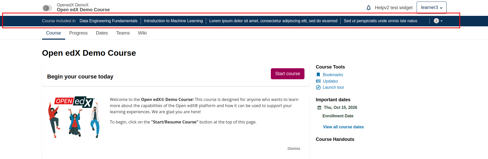
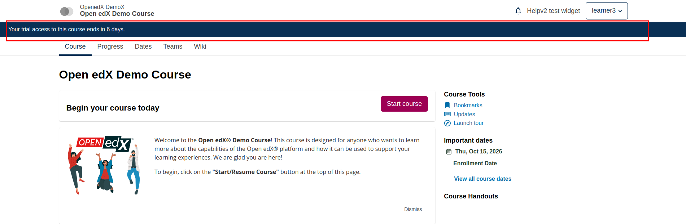

# Course Info Strip Slot

### Slot ID: `org.openedx.frontend.learning.course_info_strip.v1`

### Props:
* `courseId` - String identifier for the current course

## Description

This slot is used to replace/modify/hide the strip shown below the course header, which shows information
about the current course. For example, it can be used to tell the learner that their trial access to the
course ends soon, or that they are viewing an archived run of the course.

By default, it lists the pathways that include the current course and in which the learner is enrolled. When
the pathways do not fit in the strip, the remaining ones are shown in a "+N" popover. The default strip is not
rendered when the course is not included in any of the learner's pathways.

## Example

### Default content


### Replaced with a custom strip


The following `env.config.jsx` will replace the default strip with a custom one.

```js
import { DIRECT_PLUGIN, PLUGIN_OPERATIONS } from '@openedx/frontend-plugin-framework';

const config = {
  pluginSlots: {
    'org.openedx.frontend.learning.course_info_strip.v1': {
      keepDefault: false,
      plugins: [
        {
          op: PLUGIN_OPERATIONS.Insert,
          widget: {
            id: 'custom_course_info_strip',
            type: DIRECT_PLUGIN,
            RenderWidget: () => (
              <div className="bg-primary text-white small py-2 px-4">
                Your trial access to this course ends in 6 days.
              </div>
            ),
          },
        },
      ],
    },
  },
};

export default config;
```

To hide the strip, use `PLUGIN_OPERATIONS.Hide` with `widgetId: 'default_contents'`.
