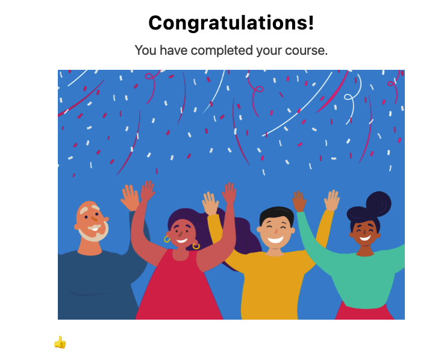

# Course Exit Slots

Slots on the course exit page, the page a learner reaches from the last unit's "next" button: the "View my courses" button, the course recommendations, and the dashboard link in the page's footnote.

- [`org.openedx.frontend.slot.learning.courseExitViewCourses.v1`](#course-exit-view-courses-slot)
- [`org.openedx.frontend.slot.learning.courseRecommendations.v1`](#course-recommendations-slot)
- [`org.openedx.frontend.slot.learning.courseExitDashboardFootnoteLink.v1`](#course-exit-dashboard-footnote-link-slot)

Several examples below use a `variant` prop. It names the state of the course exit page the learner is in, as the page reports it to analytics in `edx.ui.lms.course_exit.visited`: `nonpassing`, `in_progress`, or one of the celebration page's variants (`celebration_with_cert`, `celebration_with_unavailable_cert`, `celebration_with_requestable_cert`, `celebration_unverified`, `celebration_upgrade`, `celebration_audit_no_upgrade`, `celebration_generic`).

## Course Exit View Courses Slot

### Slot ID: `org.openedx.frontend.slot.learning.courseExitViewCourses.v1`

### Slot Props

* `courseId: string` - the ID of the current course.

### Description

This slot renders the button at the top of the course exit page, in every state of the page. Its default content is a "View my courses" button that links to the route the site provides for the `org.openedx.frontend.role.dashboard` role, or nothing if no route provides it.

### Examples

#### Linking to another page

Add the following to your site config to point the button somewhere else, in this case `example.com`. The diff below is against this package's `site.config.dev.tsx`.

```diff
-import { EnvironmentTypes, SiteConfig, footerApp, headerApp, shellApp } from '@openedx/frontend-base';
+import {
+  EnvironmentTypes, SiteConfig, WidgetOperationTypes, footerApp, headerApp, shellApp,
+} from '@openedx/frontend-base';
+import { Button } from '@openedx/paragon';

 import { learningApp } from './src';

 import '@openedx/frontend-base/shell/style';

+const ViewCoursesButton = () => (
+  <div className="row w-100 mt-2 mb-4 justify-content-end">
+    <Button variant="outline-primary" href="https://www.example.com">View my courses</Button>
+  </div>
+);
+
 const siteConfig: SiteConfig = {
   // ...
   apps: [
     shellApp,
     headerApp,
     footerApp,
     learningApp,
+    {
+      appId: 'org.example.app.myPlugin',
+      slots: [
+        {
+          slotId: 'org.openedx.frontend.slot.learning.courseExitViewCourses.v1',
+          id: 'org.example.widget.viewCoursesButton',
+          op: WidgetOperationTypes.REPLACE,
+          relatedId: 'defaultContent',
+          component: ViewCoursesButton,
+        },
+      ],
+    },
   ],
 };
```

## Course Recommendations Slot

### Slot ID: `org.openedx.frontend.slot.learning.courseRecommendations.v1`

### Slot Props

* `courseId: string` - the ID of the current course.
* `variant: string` - the state of the celebration page (see above).

### Description

This slot renders the course recommendations at the bottom of the course exit page's celebration state. Its default content is `CourseRecommendations`: up to three pages of courses recommended by the discovery service (`DISCOVERY_API_BASE_URL` in Learning's app config), or a suggestion to search the catalog when fewer than two are available.

### Examples

#### Replaced with a custom component



Add the following to your site config to replace the course recommendations with a thumbs up. The diff below is against this package's `site.config.dev.tsx`.

```diff
-import { EnvironmentTypes, SiteConfig, footerApp, headerApp, shellApp } from '@openedx/frontend-base';
+import {
+  EnvironmentTypes, SiteConfig, WidgetOperationTypes, footerApp, headerApp, shellApp,
+} from '@openedx/frontend-base';

 import { learningApp } from './src';

 import '@openedx/frontend-base/shell/style';

 const siteConfig: SiteConfig = {
   // ...
   apps: [
     shellApp,
     headerApp,
     footerApp,
     learningApp,
+    {
+      appId: 'org.example.app.myPlugin',
+      slots: [
+        {
+          slotId: 'org.openedx.frontend.slot.learning.courseRecommendations.v1',
+          id: 'org.example.widget.thumbsUp',
+          op: WidgetOperationTypes.REPLACE,
+          relatedId: 'defaultContent',
+          element: <div>👍</div>,
+        },
+      ],
+    },
   ],
 };
```

#### Using the slot's props

A component widget receives `courseId` and `variant`:

```diff
-import { learningApp } from './src';
+import { learningApp, type CourseRecommendationsSlotProps } from './src';

+const MyRecommendations = ({ courseId, variant }: CourseRecommendationsSlotProps) => (
+  <p>Recommendations for {courseId} ({variant})</p>
+);
+
 // ...
+        {
+          slotId: 'org.openedx.frontend.slot.learning.courseRecommendations.v1',
+          id: 'org.example.widget.myRecommendations',
+          op: WidgetOperationTypes.REPLACE,
+          relatedId: 'defaultContent',
+          component: MyRecommendations,
+        },
```

## Course Exit Dashboard Footnote Link Slot

### Slot ID: `org.openedx.frontend.slot.learning.courseExitDashboardFootnoteLink.v1`

### Slot Props

* `courseId: string` - the ID of the current course.
* `variant: string` - the state of the course exit page (see above).

### Description

This slot renders the link inside the footnote "You can access this course and its materials on your {link}." on the course exit page. Its default content is a "Dashboard" link to the route the site provides for the `org.openedx.frontend.role.dashboard` role, or nothing if no route provides it.

### Examples

#### Linking to another page

Add the following to your site config to point the link at `example.com`. The diff below is against this package's `site.config.dev.tsx`.

```diff
-import { EnvironmentTypes, SiteConfig, footerApp, headerApp, shellApp } from '@openedx/frontend-base';
+import {
+  EnvironmentTypes, SiteConfig, WidgetOperationTypes, footerApp, headerApp, shellApp,
+} from '@openedx/frontend-base';
+import { Hyperlink } from '@openedx/paragon';

 import { learningApp } from './src';

 import '@openedx/frontend-base/shell/style';

+const DashboardLink = () => (
+  <Hyperlink destination="https://www.example.com" className="text-reset" style={{ textDecoration: 'underline' }}>
+    Dashboard
+  </Hyperlink>
+);
+
 const siteConfig: SiteConfig = {
   // ...
   apps: [
     shellApp,
     headerApp,
     footerApp,
     learningApp,
+    {
+      appId: 'org.example.app.myPlugin',
+      slots: [
+        {
+          slotId: 'org.openedx.frontend.slot.learning.courseExitDashboardFootnoteLink.v1',
+          id: 'org.example.widget.dashboardLink',
+          op: WidgetOperationTypes.REPLACE,
+          relatedId: 'defaultContent',
+          component: DashboardLink,
+        },
+      ],
+    },
   ],
 };
```
