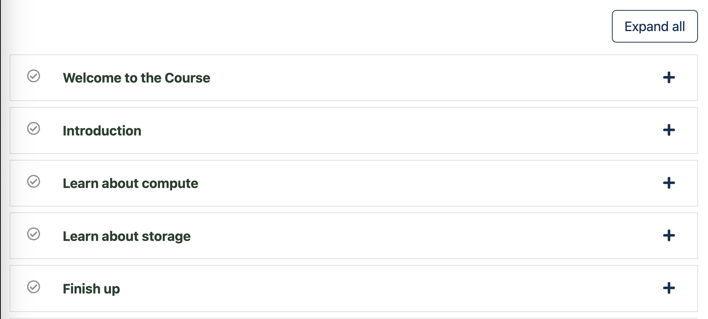
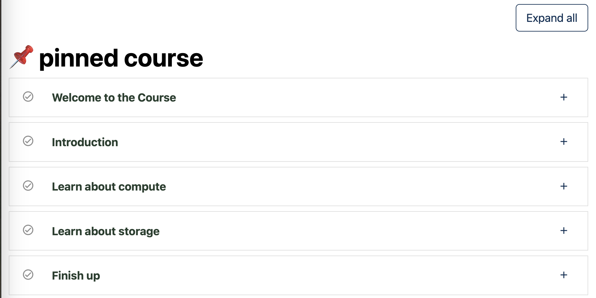

# Course Home Section Outline Slot

### Slot ID: `org.openedx.frontend.slot.learning.courseHomeSectionOutline.v1`

### Slot Props

* `courseId: string` - the ID of the current course.
* `expandAll: boolean` - whether the learner asked to expand every section with the "Expand all" button.
* `sectionIds: string[]` - the IDs of the course's sections, in outline order.
* `sections: Record<string, CourseHomeOutlineSection>` - the sections, keyed by ID.

## Description

This slot renders the list of sections on the Course Outline tab, below the "Expand all" button. Its default content is the ordered list of collapsible sections.

## Examples

### Default content



### Replaced with a custom component

Add the following to your site config to replace the section outline with a plain list of section titles. The diff below is against this package's `site.config.dev.tsx`.

```diff
-import { EnvironmentTypes, SiteConfig, footerApp, headerApp, shellApp } from '@openedx/frontend-base';
+import {
+  EnvironmentTypes, SiteConfig, WidgetOperationTypes, footerApp, headerApp, shellApp,
+} from '@openedx/frontend-base';

-import { learningApp } from './src';
+import { learningApp, type CourseHomeSectionOutlineSlotProps } from './src';

 import '@openedx/frontend-base/shell/style';

+const SectionTitles = ({ sectionIds, sections }: CourseHomeSectionOutlineSlotProps) => (
+  <ol>
+    {sectionIds.map((sectionId) => (
+      <li key={sectionId}>{sections[sectionId].title}</li>
+    ))}
+  </ol>
+);
+
 const siteConfig: SiteConfig = {
   // ...
   apps: [
     shellApp,
     headerApp,
     footerApp,
     learningApp,
+    {
+      appId: 'org.example.app.myPlugin',
+      slots: [
+        {
+          slotId: 'org.openedx.frontend.slot.learning.courseHomeSectionOutline.v1',
+          id: 'org.example.widget.sectionTitles',
+          op: WidgetOperationTypes.REPLACE,
+          relatedId: 'defaultContent',
+          component: SectionTitles,
+        },
+      ],
+    },
   ],
 };
```

### Default content with a heading above it



To keep the default sections and add something above them, insert a widget before the default content instead of replacing it:

```diff
-import { EnvironmentTypes, SiteConfig, footerApp, headerApp, shellApp } from '@openedx/frontend-base';
+import {
+  EnvironmentTypes, SiteConfig, WidgetOperationTypes, footerApp, headerApp, shellApp,
+} from '@openedx/frontend-base';

 import { learningApp } from './src';

 import '@openedx/frontend-base/shell/style';

 const siteConfig: SiteConfig = {
   // ...
   apps: [
     shellApp,
     headerApp,
     footerApp,
     learningApp,
+    {
+      appId: 'org.example.app.myPlugin',
+      slots: [
+        {
+          slotId: 'org.openedx.frontend.slot.learning.courseHomeSectionOutline.v1',
+          id: 'org.example.widget.pinnedHeading',
+          op: WidgetOperationTypes.INSERT_BEFORE,
+          relatedId: 'defaultContent',
+          element: <h1>📌 pinned course</h1>,
+        },
+      ],
+    },
   ],
 };
```
