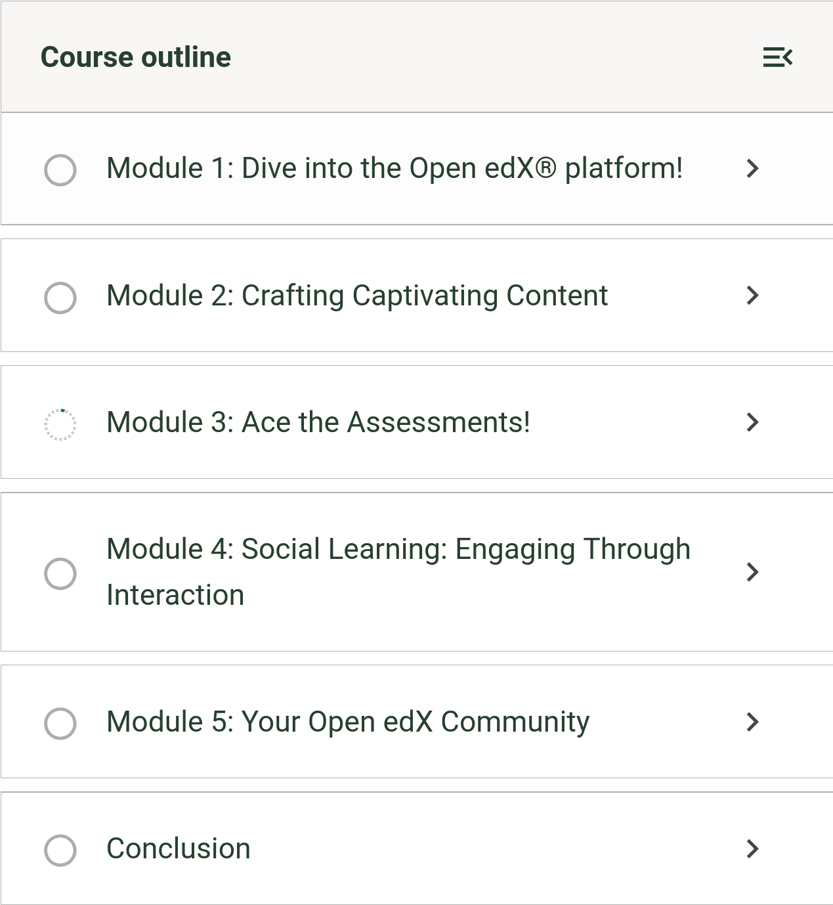
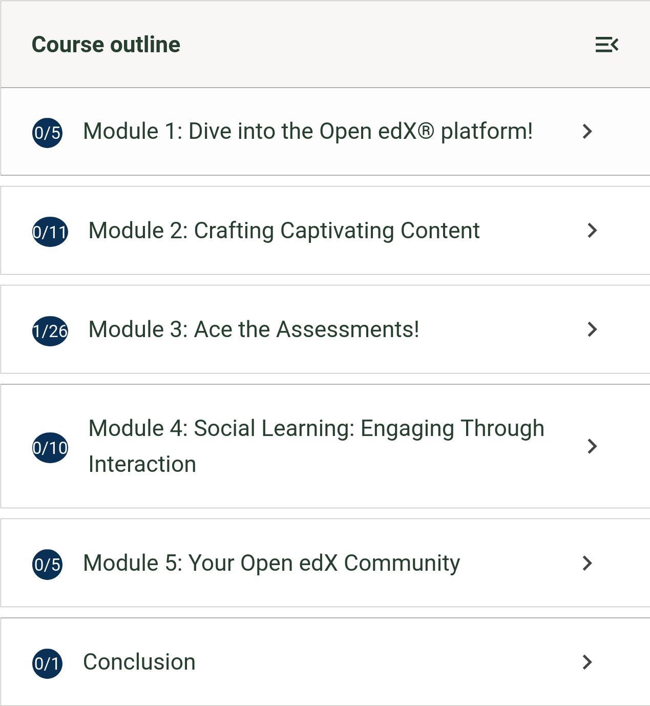
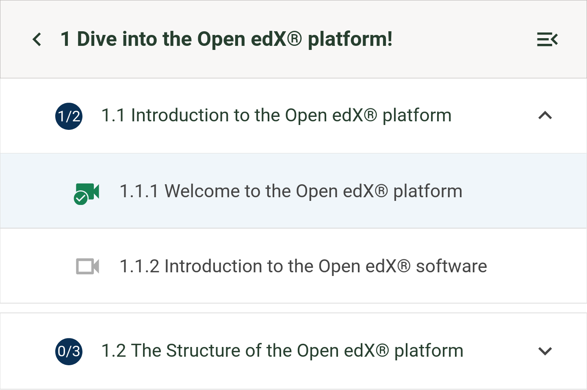

# Course Outline Sidebar Completion Icon Slot

### Slot ID: `org.openedx.frontend.slot.learning.courseOutlineSidebarCompletionIcon.v1`

### Slot Props

* `completionStat: { completed?: number; total?: number }` - how many of the row's units are complete, out of how many.
* `enabled: boolean` - whether completion tracking is enabled for the course.
* `active: boolean` - whether the row holds the current sequence (for a section) or is the current sequence.
* `variant: 'section' | 'sequence'` - which kind of row the icon is on.

## Description

This slot renders the completion icon at the start of each section and sequence row in the course outline sidebar, so many instances of it are on the page at once. Its default content is `CompletionIcon`: a check mark for a complete row, a partial dashed circle for a started one, and a grey circle otherwise.

Because the slot is shared by sections and sequences, branch on `variant` to decide what to render in each. The examples below customize one kind of row and keep `CompletionIcon` for the other.

## Examples

### Default content



### Section: replaced with a custom component



Add the following to your site config to show a bubble with the completion count on section rows. The diff below is against this package's `site.config.dev.tsx`.

```diff
-import { EnvironmentTypes, SiteConfig, footerApp, headerApp, shellApp } from '@openedx/frontend-base';
+import {
+  EnvironmentTypes, SiteConfig, WidgetOperationTypes, footerApp, headerApp, shellApp,
+} from '@openedx/frontend-base';
+import { Bubble } from '@openedx/paragon';

-import { learningApp } from './src';
+import { CompletionIcon, learningApp, type CourseOutlineSidebarCompletionIconSlotProps } from './src';

 import '@openedx/frontend-base/shell/style';

+const SectionCompletionBubble = ({
+  completionStat, enabled, active, variant,
+}: CourseOutlineSidebarCompletionIconSlotProps) => (
+  variant === 'section' ? (
+    <Bubble variant={active ? 'success' : 'primary'}>
+      {enabled && <>{completionStat.completed}/{completionStat.total}</>}
+    </Bubble>
+  ) : <CompletionIcon completionStat={completionStat} enabled={enabled} />
+);
+
 const siteConfig: SiteConfig = {
   // ...
   apps: [
     shellApp,
     headerApp,
     footerApp,
     learningApp,
+    {
+      appId: 'org.example.app.myPlugin',
+      slots: [
+        {
+          slotId: 'org.openedx.frontend.slot.learning.courseOutlineSidebarCompletionIcon.v1',
+          id: 'org.example.widget.sectionCompletionBubble',
+          op: WidgetOperationTypes.REPLACE,
+          relatedId: 'defaultContent',
+          component: SectionCompletionBubble,
+        },
+      ],
+    },
   ],
 };
```

### Sequence: replaced with a custom component



The same widget, branching the other way, shows the bubble on sequence rows instead:

```diff
+const SequenceCompletionBubble = ({
+  completionStat, enabled, active, variant,
+}: CourseOutlineSidebarCompletionIconSlotProps) => (
+  variant === 'sequence' ? (
+    <Bubble variant={active ? 'success' : 'primary'}>
+      {enabled && <>{completionStat.completed}/{completionStat.total}</>}
+    </Bubble>
+  ) : <CompletionIcon completionStat={completionStat} enabled={enabled} />
+);
+
+        {
+          slotId: 'org.openedx.frontend.slot.learning.courseOutlineSidebarCompletionIcon.v1',
+          id: 'org.example.widget.sequenceCompletionBubble',
+          op: WidgetOperationTypes.REPLACE,
+          relatedId: 'defaultContent',
+          component: SequenceCompletionBubble,
+        },
```
