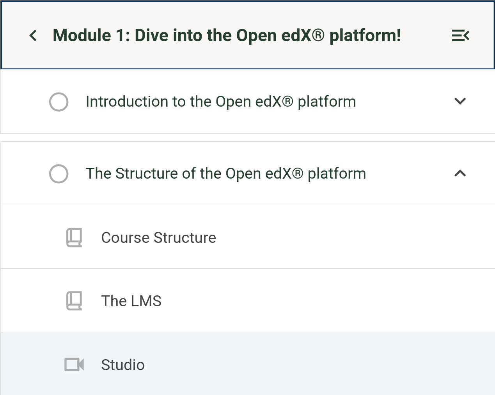

# Course Outline Sidebar Heading Slot

### Slot ID: `org.openedx.frontend.slot.learning.courseOutlineSidebarHeading.v1`

### Slot Props

* `onToggleCollapse: (() => void) | undefined` - closes the course outline sidebar.
* `isDisplaySequenceLevel: boolean` - whether the sidebar lists the sequences of one section (`true`) or the sections of the course (`false`).
* `backButton: { title: string; onClick: () => void } | undefined` - at the sequence level, the current section's title and the handler that goes back to the list of sections.

## Description

This slot renders the heading at the top of the course outline sidebar. Its default content is `CourseOutlineHeading`: the section's title as a back button at the sequence level, or "Course outline" at the section level, with the button that closes the sidebar.

In the legacy app the README listed `isSequenceLevel`, `title` and `onClickBack` as this slot's props. The slot has passed `onToggleCollapse`, `isDisplaySequenceLevel` and `backButton` all along, and those are the props listed above.

## Examples

### Wrapped with a border (custom layout)



To keep the default heading but wrap it in extra markup, replace the slot's layout (not its widget). The layout receives the list of widgets, which includes the default content, and can render it inside anything. The diff below is against this package's `site.config.dev.tsx`.

```diff
-import { EnvironmentTypes, SiteConfig, footerApp, headerApp, shellApp } from '@openedx/frontend-base';
+import {
+  EnvironmentTypes, LayoutOperationTypes, SiteConfig, footerApp, headerApp, shellApp, useWidgets,
+} from '@openedx/frontend-base';

 import { learningApp } from './src';

 import '@openedx/frontend-base/shell/style';

+const BorderedLayout = () => {
+  const widgets = useWidgets();
+  return <div style={{ border: '2px solid var(--pgn-color-primary-base)' }}>{widgets}</div>;
+};
+
 const siteConfig: SiteConfig = {
   // ...
   apps: [
     shellApp,
     headerApp,
     footerApp,
     learningApp,
+    {
+      appId: 'org.example.app.myPlugin',
+      slots: [
+        {
+          slotId: 'org.openedx.frontend.slot.learning.courseOutlineSidebarHeading.v1',
+          op: LayoutOperationTypes.REPLACE,
+          component: BorderedLayout,
+        },
+      ],
+    },
   ],
 };
```

### Replaced with a custom component

To replace the heading, replace the default content with a component that reads the slot's props:

```diff
-import { learningApp } from './src';
+import { learningApp, type CourseOutlineSidebarHeadingSlotProps } from './src';

+const PlainHeading = ({ isDisplaySequenceLevel, backButton, onToggleCollapse }: CourseOutlineSidebarHeadingSlotProps) => (
+  <div className="d-flex justify-content-between p-2.5">
+    {isDisplaySequenceLevel && backButton
+      ? <button type="button" onClick={backButton.onClick}>{backButton.title}</button>
+      : <strong>Outline</strong>}
+    {onToggleCollapse && <button type="button" onClick={onToggleCollapse}>Close</button>}
+  </div>
+);
+
+        {
+          slotId: 'org.openedx.frontend.slot.learning.courseOutlineSidebarHeading.v1',
+          id: 'org.example.widget.plainHeading',
+          op: WidgetOperationTypes.REPLACE,
+          relatedId: 'defaultContent',
+          component: PlainHeading,
+        },
```
