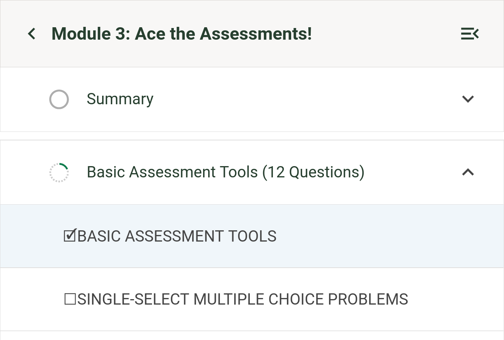

# Course Outline Sidebar Unit Slot

### Slot ID: `org.openedx.frontend.slot.learning.courseOutlineSidebarUnit.v1`

### Slot Props

* `unit: { complete?: boolean; icon?: string; id?: string; title?: string; type?: string }` - the unit, as the navigation sidebar's outline describes it.
* `icon: ReactNode` - the unit's icon, already rendered: its type's icon, a lock when the unit is locked, in green when it is complete.
* `isLocked: boolean` - whether the unit is locked.
* `isCompletionTrackingEnabled: boolean` - whether completion tracking is enabled for the course.

## Description

This slot renders the contents of each unit row in the course outline sidebar, so many instances of it are on the page at once. The contents sit inside the unit's link, so a widget replaces what is shown for the unit (its icon and title) while the link and the list item around it stay. Its default content is `SidebarUnitContent`: the icon, the title and, when completion tracking is enabled, a screen-reader note saying whether the unit is complete.

## Examples

### Replaced with a custom component



Add the following to your site config to replace each unit's contents with a mark for whether it is locked, complete or incomplete, followed by its title in upper case. The diff below is against this package's `site.config.dev.tsx`.

```diff
-import { EnvironmentTypes, SiteConfig, footerApp, headerApp, shellApp } from '@openedx/frontend-base';
+import {
+  EnvironmentTypes, SiteConfig, WidgetOperationTypes, footerApp, headerApp, shellApp,
+} from '@openedx/frontend-base';

-import { learningApp } from './src';
+import { learningApp, type CourseOutlineSidebarUnitSlotProps } from './src';

 import '@openedx/frontend-base/shell/style';

+const UnitStatus = ({ unit, isLocked, isCompletionTrackingEnabled }: CourseOutlineSidebarUnitSlotProps) => {
+  let unitStatus = '';
+  if (isLocked) {
+    unitStatus = '🔒';
+  } else if (isCompletionTrackingEnabled) {
+    unitStatus = unit.complete ? '🗹' : '☐';
+  }
+  return (
+    <span>
+      {unitStatus}
+      {unit.title?.toUpperCase()}
+    </span>
+  );
+};
+
 const siteConfig: SiteConfig = {
   // ...
   apps: [
     shellApp,
     headerApp,
     footerApp,
     learningApp,
+    {
+      appId: 'org.example.app.myPlugin',
+      slots: [
+        {
+          slotId: 'org.openedx.frontend.slot.learning.courseOutlineSidebarUnit.v1',
+          id: 'org.example.widget.unitStatus',
+          op: WidgetOperationTypes.REPLACE,
+          relatedId: 'defaultContent',
+          component: UnitStatus,
+        },
+      ],
+    },
   ],
 };
```
