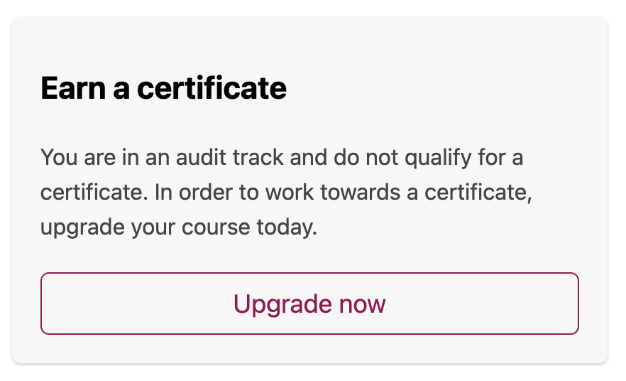

# Progress Certificate Status Slot

### Slot ID: `org.openedx.frontend.slot.learning.progressCertificateStatus.v1`

### Slot Props

* `courseId: string` - the ID of the current course.

## Description

This slot renders the body of the certificate status card on the Progress tab: its header, message and button. Its default content is that body, which tells the learner where they stand on earning a certificate (for example, that they can upgrade to earn one). The card around it, and whether it shows at all, stay the Progress tab's.

## Examples

### Default content



### Replaced with a custom component

Add the following to your site config to replace the card's body with your own message. The diff below is against this package's `site.config.dev.tsx`.

```diff
-import { EnvironmentTypes, SiteConfig, footerApp, headerApp, shellApp } from '@openedx/frontend-base';
+import {
+  EnvironmentTypes, SiteConfig, WidgetOperationTypes, footerApp, headerApp, shellApp,
+} from '@openedx/frontend-base';

-import { learningApp } from './src';
+import { learningApp, type ProgressCertificateStatusSlotProps } from './src';

 import '@openedx/frontend-base/shell/style';

+const CertificateNote = ({ courseId }: ProgressCertificateStatusSlotProps) => (
+  <div className="m-3">
+    <h3>Upgrade certificate</h3>
+    <p>{courseId}</p>
+  </div>
+);
+
 const siteConfig: SiteConfig = {
   // ...
   apps: [
     shellApp,
     headerApp,
     footerApp,
     learningApp,
+    {
+      appId: 'org.example.app.myPlugin',
+      slots: [
+        {
+          slotId: 'org.openedx.frontend.slot.learning.progressCertificateStatus.v1',
+          id: 'org.example.widget.certificateNote',
+          op: WidgetOperationTypes.REPLACE,
+          relatedId: 'defaultContent',
+          component: CertificateNote,
+        },
+      ],
+    },
   ],
 };
```
