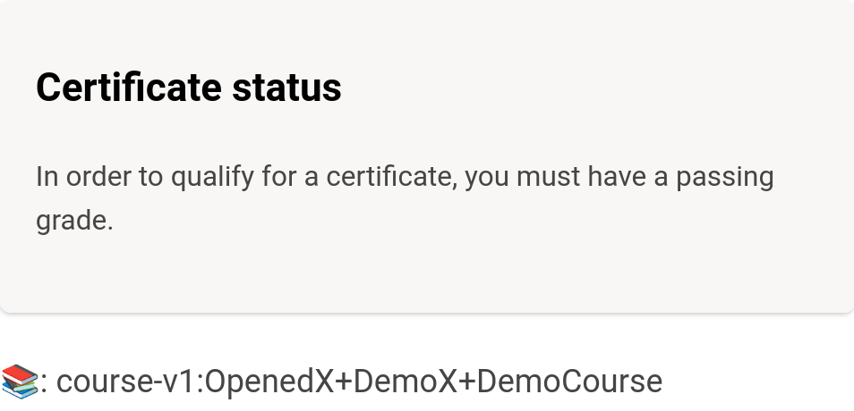

# Progress Tab Certificate Status Side Panel Slot

### Slot ID: `org.openedx.frontend.slot.learning.progressTabCertificateStatusSidePanel.v1`

### Slot Props

* `courseId: string` - the ID of the current course.

## Description

This slot renders the certificate status card at the top of the side panel of the Progress tab. Its default content is `CertificateStatus`, on wide screens only: on narrow screens the card is in the main body instead (see the [main body slot](../ProgressTabCertificateStatusMainBodySlot/README.md)).

## Examples

### Added custom component after the default content



Add the following to your site config to show the course ID below the certificate status card. The diff below is against this package's `site.config.dev.tsx`.

```diff
-import { EnvironmentTypes, SiteConfig, footerApp, headerApp, shellApp } from '@openedx/frontend-base';
+import {
+  EnvironmentTypes, SiteConfig, WidgetOperationTypes, footerApp, headerApp, shellApp,
+} from '@openedx/frontend-base';

-import { learningApp } from './src';
+import { learningApp, type ProgressTabCertificateStatusSidePanelSlotProps } from './src';

 import '@openedx/frontend-base/shell/style';

+const CourseIdNote = ({ courseId }: ProgressTabCertificateStatusSidePanelSlotProps) => (
+  <div>
+    <p>📚: {courseId}</p>
+  </div>
+);
+
 const siteConfig: SiteConfig = {
   // ...
   apps: [
     shellApp,
     headerApp,
     footerApp,
     learningApp,
+    {
+      appId: 'org.example.app.myPlugin',
+      slots: [
+        {
+          slotId: 'org.openedx.frontend.slot.learning.progressTabCertificateStatusSidePanel.v1',
+          id: 'org.example.widget.courseIdNote',
+          op: WidgetOperationTypes.APPEND,
+          component: CourseIdNote,
+        },
+      ],
+    },
   ],
 };
```

The widget shows on every screen width, also where the default content does not. To replace the certificate status card instead, use `op: WidgetOperationTypes.REPLACE` with `relatedId: 'defaultContent'`.
