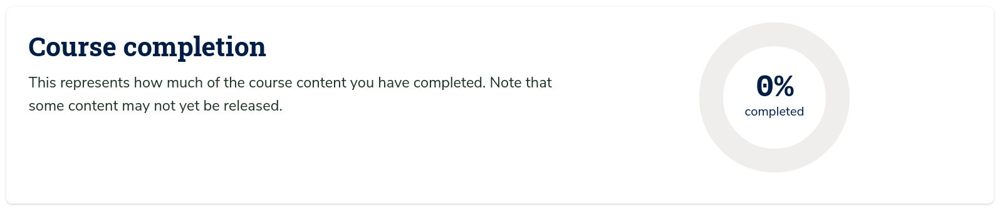
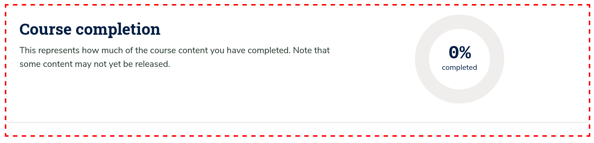

# Progress Tab Course Completion Slot

### Slot ID: `org.openedx.frontend.slot.learning.progressTabCourseCompletion.v1`

### Slot Props

* `courseId: string` - the ID of the current course.
* `enableProgressGraph: boolean` - whether the progress graph is enabled for the course.

## Description

This slot renders the course completion chart at the top of the main body of the Progress tab. Its default content is `CourseCompletion`, when `enableProgressGraph` is `true`; otherwise there is none.

## Examples

### Default content



### Wrapped with a dashed border (custom layout)



To keep the default content but wrap it in extra markup, replace the slot's layout (not its widget). The layout receives the list of widgets, which includes the default content, and can render it inside anything. The diff below is against this package's `site.config.dev.tsx`.

```diff
-import { EnvironmentTypes, SiteConfig, footerApp, headerApp, shellApp } from '@openedx/frontend-base';
+import {
+  EnvironmentTypes, LayoutOperationTypes, SiteConfig, footerApp, headerApp, shellApp, useWidgets,
+} from '@openedx/frontend-base';

 import { learningApp } from './src';

 import '@openedx/frontend-base/shell/style';

+const DashedBorderLayout = () => {
+  const widgets = useWidgets();
+  return <div style={{ border: '3px dashed red' }}>{widgets}</div>;
+};
+
 const siteConfig: SiteConfig = {
   // ...
   apps: [
     shellApp,
     headerApp,
     footerApp,
     learningApp,
+    {
+      appId: 'org.example.app.myPlugin',
+      slots: [
+        {
+          slotId: 'org.openedx.frontend.slot.learning.progressTabCourseCompletion.v1',
+          op: LayoutOperationTypes.REPLACE,
+          component: DashedBorderLayout,
+        },
+      ],
+    },
   ],
 };
```

### Replaced with a custom component

To replace the chart instead, for example with one that also shows when the progress graph is disabled, replace the default content with a component that reads the slot's props:

```diff
-import { learningApp } from './src';
+import { learningApp, type ProgressTabCourseCompletionSlotProps } from './src';

+const CompletionNote = ({ courseId, enableProgressGraph }: ProgressTabCourseCompletionSlotProps) => (
+  <p>{enableProgressGraph ? `Progress for ${courseId}` : 'Progress graph disabled'}</p>
+);
+
+        {
+          slotId: 'org.openedx.frontend.slot.learning.progressTabCourseCompletion.v1',
+          id: 'org.example.widget.completionNote',
+          op: WidgetOperationTypes.REPLACE,
+          relatedId: 'defaultContent',
+          component: CompletionNote,
+        },
```

When `enableProgressGraph` is `false` there is no default content to replace, so use `op: WidgetOperationTypes.APPEND` (without `relatedId`) for a widget that should show either way.
