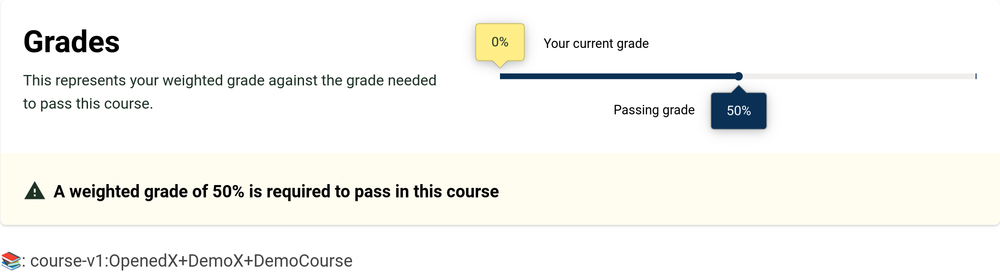

# Progress Tab Course Grade Slot

### Slot ID: `org.openedx.frontend.slot.learning.progressTabCourseGrade.v1`

### Slot Props

* `courseId: string` - the ID of the current course.

## Description

This slot renders the course grade card in the main body of the Progress tab. Its default content is `CourseGrade`: the learner's current grade against the passing grade.

## Examples

### Added custom component after the default content



Add the following to your site config to show the course ID below the course grade card. The diff below is against this package's `site.config.dev.tsx`.

```diff
-import { EnvironmentTypes, SiteConfig, footerApp, headerApp, shellApp } from '@openedx/frontend-base';
+import {
+  EnvironmentTypes, SiteConfig, WidgetOperationTypes, footerApp, headerApp, shellApp,
+} from '@openedx/frontend-base';

-import { learningApp } from './src';
+import { learningApp, type ProgressTabCourseGradeSlotProps } from './src';

 import '@openedx/frontend-base/shell/style';

+const CourseIdNote = ({ courseId }: ProgressTabCourseGradeSlotProps) => (
+  <div>
+    <p>📚: {courseId}</p>
+  </div>
+);
+
 const siteConfig: SiteConfig = {
   // ...
   apps: [
     shellApp,
     headerApp,
     footerApp,
     learningApp,
+    {
+      appId: 'org.example.app.myPlugin',
+      slots: [
+        {
+          slotId: 'org.openedx.frontend.slot.learning.progressTabCourseGrade.v1',
+          id: 'org.example.widget.courseIdNote',
+          op: WidgetOperationTypes.APPEND,
+          component: CourseIdNote,
+        },
+      ],
+    },
   ],
 };
```

To replace the course grade card instead, use `op: WidgetOperationTypes.REPLACE` with `relatedId: 'defaultContent'`.

### Reading the learner's exam attempts

A widget in this slot can also read the learner's exam attempts with `useExamsData()`: see the Progress tab's [README](../../course-home/progress-tab/README.md).
