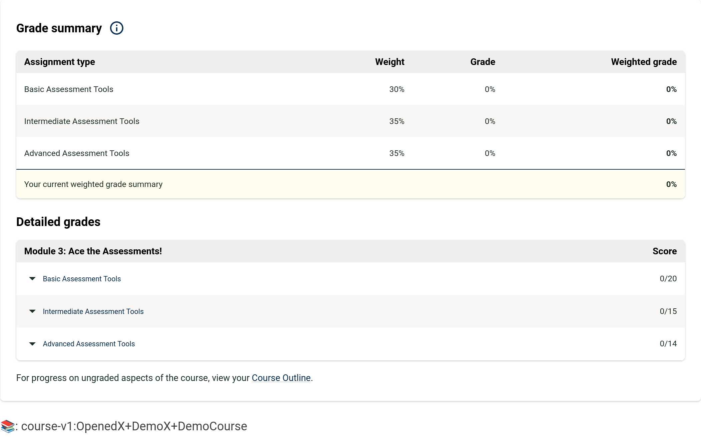

# Progress Tab Grade Breakdown Slot

### Slot ID: `org.openedx.frontend.slot.learning.progressTabGradeBreakdown.v1`

### Slot Props

* `courseId: string` - the ID of the current course.

## Description

This slot renders the grade breakdown in the main body of the Progress tab, below the course grade. Its default content is the grade summary by assignment type and the detailed grades by subsection, in one card.

## Examples

### Added custom component after the default content



Add the following to your site config to show the course ID below the grade breakdown card. The diff below is against this package's `site.config.dev.tsx`.

```diff
-import { EnvironmentTypes, SiteConfig, footerApp, headerApp, shellApp } from '@openedx/frontend-base';
+import {
+  EnvironmentTypes, SiteConfig, WidgetOperationTypes, footerApp, headerApp, shellApp,
+} from '@openedx/frontend-base';

-import { learningApp } from './src';
+import { learningApp, type ProgressTabGradeBreakdownSlotProps } from './src';

 import '@openedx/frontend-base/shell/style';

+const CourseIdNote = ({ courseId }: ProgressTabGradeBreakdownSlotProps) => (
+  <div>
+    <p>📚: {courseId}</p>
+  </div>
+);
+
 const siteConfig: SiteConfig = {
   // ...
   apps: [
     shellApp,
     headerApp,
     footerApp,
     learningApp,
+    {
+      appId: 'org.example.app.myPlugin',
+      slots: [
+        {
+          slotId: 'org.openedx.frontend.slot.learning.progressTabGradeBreakdown.v1',
+          id: 'org.example.widget.courseIdNote',
+          op: WidgetOperationTypes.APPEND,
+          component: CourseIdNote,
+        },
+      ],
+    },
   ],
 };
```

To replace the grade breakdown instead, use `op: WidgetOperationTypes.REPLACE` with `relatedId: 'defaultContent'`.
