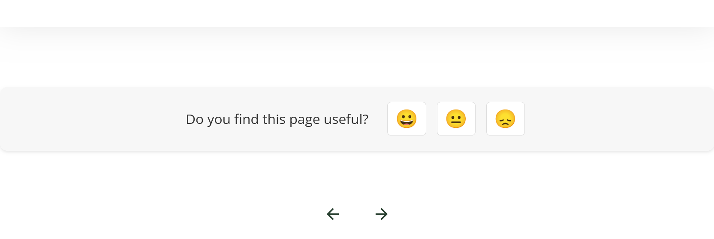

# Sequence Bottom Navigation Slot

### Slot ID: `org.openedx.frontend.slot.learning.sequenceBottomNavigation.v1`

### Slot Props

* `courseId: string` - the ID of the current course.
* `sequenceId: string` - the ID of the current sequence.
* `unitId: string | null` - the ID of the current unit.
* `onClickNext: () => void` - call when the learner moves to the next unit; it logs the event and does the sequence's own bookkeeping. Navigating is up to the widget.
* `onNavigate: (unitId: string) => void` - call when the learner picks a unit directly, with that unit's ID.
* `onClickPrevious: () => void` - call when the learner moves to the previous unit.

## Description

This slot renders below the unit content, once the unit has loaded. Its default content is `UnitNavigation`: the "Previous" and "Next" buttons, the latter naming the end of the course on the last unit.

## Examples

### Replaced with the top navigation arrows



Add the following to your site config to show the compact arrows used beside the unit title instead of the buttons. The diff below is against this package's `site.config.dev.tsx`.

```diff
-import { EnvironmentTypes, SiteConfig, footerApp, headerApp, shellApp } from '@openedx/frontend-base';
+import {
+  EnvironmentTypes, SiteConfig, WidgetOperationTypes, footerApp, headerApp, shellApp,
+} from '@openedx/frontend-base';

-import { learningApp } from './src';
+import { learningApp, UnitNavigation, type SequenceBottomNavigationSlotProps } from './src';

 import '@openedx/frontend-base/shell/style';

+const ArrowNavigation = ({
+  courseId, sequenceId, unitId, onClickNext, onClickPrevious,
+}: SequenceBottomNavigationSlotProps) => (
+  <div className="d-flex justify-content-center align-items-center">
+    <UnitNavigation
+      courseId={courseId}
+      sequenceId={sequenceId}
+      unitId={unitId}
+      isAtTop
+      onClickPrevious={onClickPrevious}
+      onClickNext={onClickNext}
+    />
+  </div>
+);
+
 const siteConfig: SiteConfig = {
   // ...
   apps: [
     shellApp,
     headerApp,
     footerApp,
     learningApp,
+    {
+      appId: 'org.example.app.myPlugin',
+      slots: [
+        {
+          slotId: 'org.openedx.frontend.slot.learning.sequenceBottomNavigation.v1',
+          id: 'org.example.widget.arrowNavigation',
+          op: WidgetOperationTypes.REPLACE,
+          relatedId: 'defaultContent',
+          component: ArrowNavigation,
+        },
+      ],
+    },
   ],
 };
```
