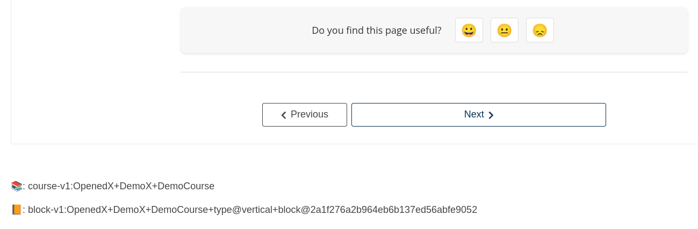

# Sequence Container Slot

### Slot ID: `org.openedx.frontend.slot.learning.sequenceContainer.v1`

### Slot Props

* `courseId: string` - the ID of the current course.
* `sequenceId: string | null` - the ID of the current sequence.
* `unitId: string | null` - the ID of the current unit.

## Description

This slot renders below the sequence, after the unit content and its previous and next buttons. It has no default content: it renders nothing until a site adds a widget.

## Examples

### Added custom component



Add the following to your site config to show the course and unit IDs below the sequence. The diff below is against this package's `site.config.dev.tsx`.

```diff
-import { EnvironmentTypes, SiteConfig, footerApp, headerApp, shellApp } from '@openedx/frontend-base';
+import {
+  EnvironmentTypes, SiteConfig, WidgetOperationTypes, footerApp, headerApp, shellApp,
+} from '@openedx/frontend-base';

-import { learningApp } from './src';
+import { learningApp, type SequenceContainerSlotProps } from './src';

 import '@openedx/frontend-base/shell/style';

+const SequenceDetails = ({ courseId, unitId }: SequenceContainerSlotProps) => (
+  <div>
+    <p>📚: {courseId}</p>
+    <p>📙: {unitId}</p>
+  </div>
+);
+
 const siteConfig: SiteConfig = {
   // ...
   apps: [
     shellApp,
     headerApp,
     footerApp,
     learningApp,
+    {
+      appId: 'org.example.app.myPlugin',
+      slots: [
+        {
+          slotId: 'org.openedx.frontend.slot.learning.sequenceContainer.v1',
+          id: 'org.example.widget.sequenceDetails',
+          op: WidgetOperationTypes.APPEND,
+          component: SequenceDetails,
+        },
+      ],
+    },
   ],
 };
```
