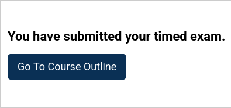

# Submitted Timed Exam Instructions Slot

### Slot ID: `org.openedx.frontend.slot.learning.submittedTimedExamInstructions.v1`

### Slot Props

* `timeIsOver: boolean` - whether the exam was submitted because its time limit ran out, rather than by the learner.

## Description

This slot renders the heading of the page a learner sees after submitting a timed exam. The special exams library (`@edx/frontend-lib-special-exams`) renders it, through the `submittedTimedExamInstructions` prop of `SequenceExamWrapper`. Its default content is the heading: "You have submitted your timed exam.", or, when `timeIsOver` is true, a heading saying the time ran out and the exam was submitted.

## Examples

### Default content


### Replaced with a custom component

Add the following to your site config to replace the heading with your own messages. The diff below is against this package's `site.config.dev.tsx`.


```diff
-import { EnvironmentTypes, SiteConfig, footerApp, headerApp, shellApp } from '@openedx/frontend-base';
+import {
+  EnvironmentTypes, SiteConfig, WidgetOperationTypes, footerApp, headerApp, shellApp,
+} from '@openedx/frontend-base';

-import { learningApp } from './src';
+import { learningApp, type SubmittedTimedExamInstructionsSlotProps } from './src';

 import '@openedx/frontend-base/shell/style';

+const CustomInstructions = ({ timeIsOver }: SubmittedTimedExamInstructionsSlotProps) => (
+  <h3 className="h3">
+    {timeIsOver
+      ? "Time's up! Your exam has been submitted for review."
+      : 'Great job! Your exam submission was successful.'}
+  </h3>
+);
+
 const siteConfig: SiteConfig = {
   // ...
   apps: [
     shellApp,
     headerApp,
     footerApp,
     learningApp,
+    {
+      appId: 'org.example.app.myPlugin',
+      slots: [
+        {
+          slotId: 'org.openedx.frontend.slot.learning.submittedTimedExamInstructions.v1',
+          id: 'org.example.widget.customInstructions',
+          op: WidgetOperationTypes.REPLACE,
+          relatedId: 'defaultContent',
+          component: CustomInstructions,
+        },
+      ],
+    },
   ],
 };
```

### Added after the default content

Add the following to your site config to keep the heading and add a "Go To Course Outline" button under it.



```diff
-import { EnvironmentTypes, SiteConfig, footerApp, headerApp, shellApp } from '@openedx/frontend-base';
+import {
+  EnvironmentTypes, SiteConfig, WidgetOperationTypes, footerApp, headerApp, shellApp, useSiteConfig,
+} from '@openedx/frontend-base';
+import { Button } from '@openedx/paragon';
+import { useParams } from 'react-router-dom';

 import { learningApp } from './src';

 import '@openedx/frontend-base/shell/style';

+const CourseOutlineButton = () => {
+  const { courseId } = useParams();
+  const { lmsBaseUrl } = useSiteConfig();
+  return (
+    <div className="mt-3">
+      <Button href={`${lmsBaseUrl}/courses/${courseId}/course/`}>Go To Course Outline</Button>
+    </div>
+  );
+};
+
 const siteConfig: SiteConfig = {
   // ...
   apps: [
     shellApp,
     headerApp,
     footerApp,
     learningApp,
+    {
+      appId: 'org.example.app.myPlugin',
+      slots: [
+        {
+          slotId: 'org.openedx.frontend.slot.learning.submittedTimedExamInstructions.v1',
+          id: 'org.example.widget.courseOutlineButton',
+          op: WidgetOperationTypes.INSERT_AFTER,
+          relatedId: 'defaultContent',
+          component: CourseOutlineButton,
+        },
+      ],
+    },
   ],
 };
```
