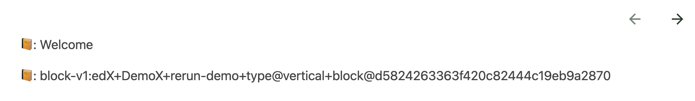

# Unit Title Slot

### Slot ID: `org.openedx.frontend.slot.learning.unitTitle.v1`

### Slot Props

* `courseId: string` - the ID of the current course.
* `sequenceId: string` - the ID of the sequence holding the unit.
* `unitId: string` - the ID of the current unit.
* `unit: SequenceUnit` - the unit, as the sequence metadata describes it: `title`, `bookmarked`, `complete` and so on.
* `renderUnitNavigation: (isAtTop: boolean) => ReactNode` - renders the previous and next buttons; `true` gives the compact arrows shown beside the title.

## Description

This slot renders the top of a unit, above its content. Its default content is the unit title with the previous and next arrows beside it, and the bookmark button below it.

In the legacy app this slot also passed `isEnabledOutlineSidebar`, which was always `true`. That prop is gone.

## Examples

### Content added after the unit title



Add the following to your site config to keep the default title and add the unit's title and ID after it. The diff below is against this package's `site.config.dev.tsx`.

```diff
-import { EnvironmentTypes, SiteConfig, footerApp, headerApp, shellApp } from '@openedx/frontend-base';
+import {
+  EnvironmentTypes, SiteConfig, WidgetOperationTypes, footerApp, headerApp, shellApp,
+} from '@openedx/frontend-base';

-import { learningApp } from './src';
+import { learningApp, type UnitTitleSlotProps } from './src';

 import '@openedx/frontend-base/shell/style';

+const UnitDetails = ({ unitId, unit }: UnitTitleSlotProps) => (
+  <>
+    <p>📙: {unit.title}</p>
+    <p>📙: {unitId}</p>
+  </>
+);
+
 const siteConfig: SiteConfig = {
   // ...
   apps: [
     shellApp,
     headerApp,
     footerApp,
     learningApp,
+    {
+      appId: 'org.example.app.myPlugin',
+      slots: [
+        {
+          slotId: 'org.openedx.frontend.slot.learning.unitTitle.v1',
+          id: 'org.example.widget.unitDetails',
+          op: WidgetOperationTypes.INSERT_AFTER,
+          relatedId: 'defaultContent',
+          component: UnitDetails,
+        },
+      ],
+    },
   ],
 };
```

### Replaced with a custom component

To replace the default content, `REPLACE` it, and call `renderUnitNavigation(true)` where the arrows should go:

```diff
+const PlainTitle = ({ unit, renderUnitNavigation }: UnitTitleSlotProps) => (
+  <div className="d-flex justify-content-between">
+    <h3>{unit.title}</h3>
+    {renderUnitNavigation(true)}
+  </div>
+);
+
 const siteConfig: SiteConfig = {
   // ...
   apps: [
     // ...
+    {
+      appId: 'org.example.app.myPlugin',
+      slots: [
+        {
+          slotId: 'org.openedx.frontend.slot.learning.unitTitle.v1',
+          id: 'org.example.widget.plainTitle',
+          op: WidgetOperationTypes.REPLACE,
+          relatedId: 'defaultContent',
+          component: PlainTitle,
+        },
+      ],
+    },
   ],
 };
```
